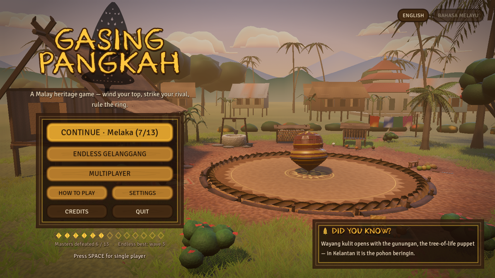
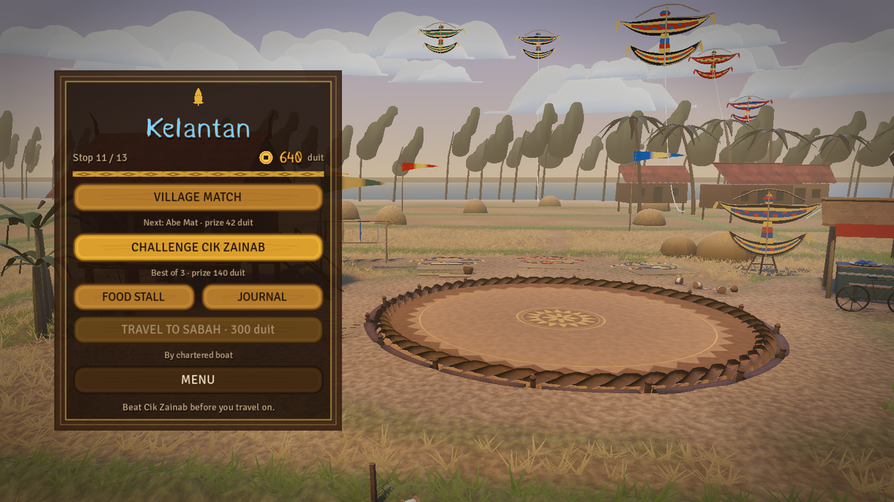
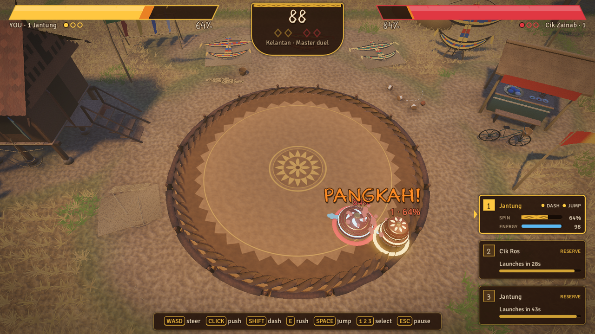
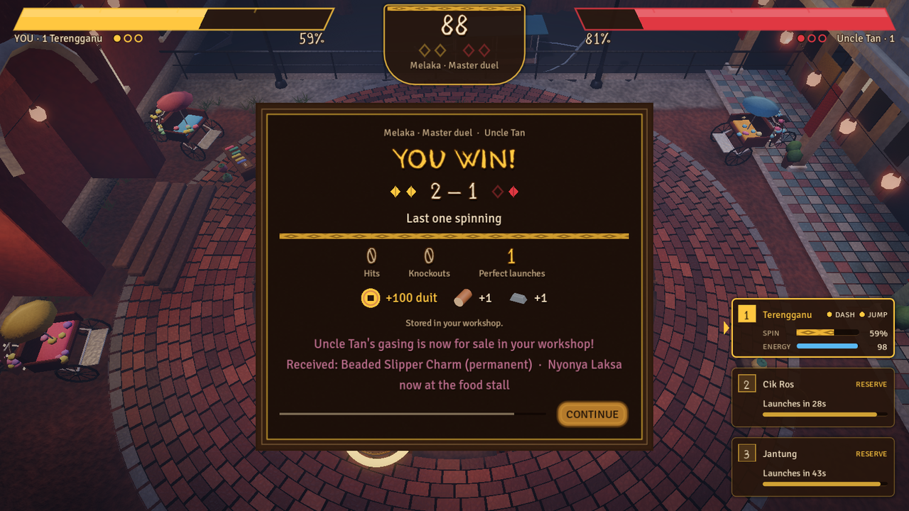
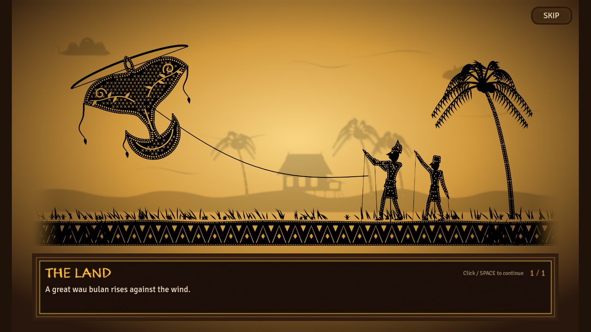
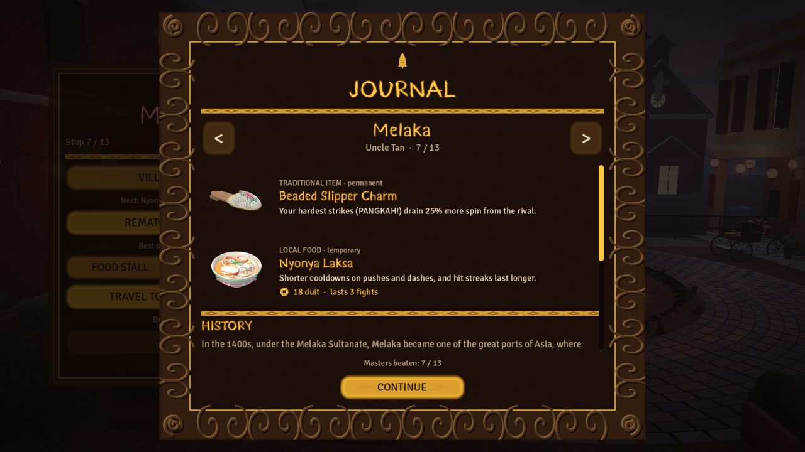
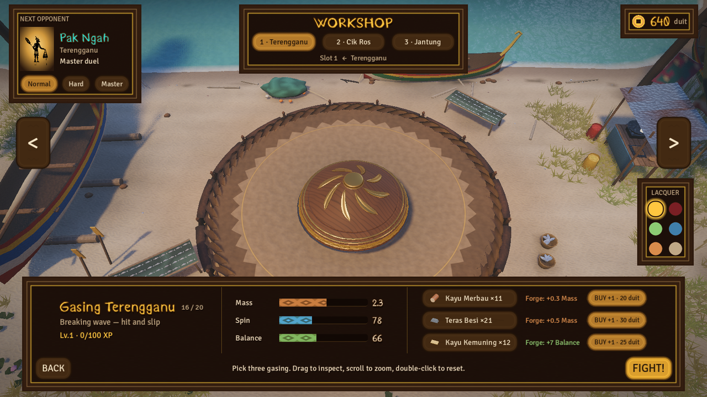
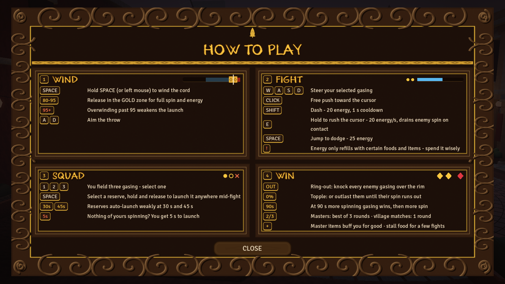

# Gasing Pangkah

Godot 4.7 arena battler built around the Malaysian spinning top. It has a 13-state story journey, a gasing workshop, an endless mode and 2–4 player LAN/Steam FFA. Open `project.godot` in the GodotSteam-enabled Godot build used by this project and run `main.tscn`.

| Title | Village hub | Battle | Round result |
| --- | --- | --- | --- |
|  |  |  |  |

| Wayang cutscene | Journal | Workshop | How to play |
| --- | --- | --- | --- |
|  |  |  |  |

## Modes

- **Story journey:** a shipwrecked foreign sailor travels through all 13 states, from Perlis to Sarawak, and beats each state's gasing master (see below). Progress is saved, and the title offers CONTINUE with the current stop and 13 progress pips.
- **Endless Gelanggang:** one round per wave against the 13 masters in travel order, then Mahaguru Merdeka of Kuala Lumpur as the boss wave. The roster then repeats with stronger stats. Your story items and dishes don't apply here. From the second lap, masters regain their own buffs at 35% per lap, capped. Wave n pays 4 + 4n duit, and your best wave is recorded.
- **Multiplayer:** 2–4 player FFA over LAN or Steam (see below).

Settings (volume for master, music and SFX; fullscreen; low graphics; English or Bahasa Melayu) are saved in `user://settings.cfg`. HOW TO PLAY on the title screen explains the controls.

## The sailor's journey

A storm wrecks the sailor's ship on the Perlis coast. A fishing village takes them in, and the sailor sees gasing for the first time. Each state has a respected master who won't teach the sailor anything until the sailor beats them. Travel order: Perlis → Kedah → Penang → Perak → Selangor → Negeri Sembilan → Melaka → Johor → Pahang → Terengganu → Kelantan → Sabah → Sarawak.

**Arrival.** Every state opens with a wayang kulit cutscene. If you came by transport, the ride plays first. Then come four beats: the land, the people, the food, and the master (a top drops and spins, then the master's puppet steps in). Click or Space advances; Esc or SKIP skips. The very first arrival starts with the shipwreck and goes straight into a one-round first match against a Perlis villager, which doubles as the tutorial.

**Village hub.** Between fights you stand at a plaque over the state's arena:

- **VILLAGE MATCH:** one round against a local on a base top. A win pays 9 + 3 × the stop number in duit (12 in Perlis, 48 in Sarawak); a loss pays nothing. This is how you farm fares.
- **CHALLENGE <master>:** a best-of-3 duel in the master's own arena and style, for example Pak Latif's patient play, Mak Cik Ramlah copying your build, or Pak Ngah fighting with the tide. The first win pays 40–160 duit, unlocks that master's top in the workshop shop and opens their journal page. Rematches pay 40%.
- **FOOD STALL:** the dishes of every state you have beaten. One dish is active at a time and lasts its listed number of fights; a best-of-3 duel counts as one fight. Buying takes a second, confirming press.
- **JOURNAL:** one page per state. A beaten state shows the master, three short entries (history, tradition, food), the item and the dish. Unbeaten states read "???". The pause menu opens it too.
- **TRAVEL:** unlocks once the master falls. Pay the fare on a second press and ride on. Fares rise from 70 (Perlis's bullock cart) to 300 (Kelantan's chartered boat to Sabah), about three village wins per stop.

Fights go hub → workshop loadout → wind-up. After a village match or a lost duel you return to the workshop, so one click fights again. A won duel returns you to the hub. Leaving a story fight from the pause menu counts as a loss and returns to the village. Progress is never reset.

**Items and food.** Each master gives a traditional item, a permanent buff. All items stack, and each buff has a cap. Food is temporary and comes from the stall. Both work in village and master fights only. The tutorial, Endless and multiplayer use plain stats.

| State | Master | Item (permanent) | Dish (price, fights) |
| --- | --- | --- | --- |
| Perlis | Pak Latif | Hand-carved Top: stability | Laksa Perlis (10, 3): energy refill |
| Kedah | Mak Semah | Irrigation-gate Charm: wider perfect launch | Nasi Ulam (12, 3): aim assist |
| Penang | Ah Kow | Market Vendor's Bell: speed on hit streaks | Asam Laksa (16, 3): attack |
| Perak | Uncle Chandran | Miner's Lamp Trinket: hazard resistance | Ipoh Hor Fun (16, 3): defence |
| Selangor | Danial | Batik Cloth Wrap: attack, defence, stability | Nasi Lemak (14, 4): balanced, slow refill |
| Negeri Sembilan | Mak Cik Ramlah | Woven Adat Sash: resists repeated hits | Rendang (20, 1): strong attack |
| Melaka | Uncle Tan | Beaded Slipper Charm: harder PANGKAH! hits | Nyonya Laksa (18, 3): shorter cooldowns |
| Johor | Pak Zaid | Dockworker's Rope Charm: slower spin loss while wobbling | Laksa Johor (20, 3): energy refill |
| Pahang | Along | Hill Farmer's Woven Hat: hazard resistance, stability | Hill Vegetable Stir-fry (12, 3): defence |
| Terengganu | Pak Ngah | Songket Thread Bracelet: lucky half-damage hits | Keropok Lekor (18, 3): speed |
| Kelantan | Cik Zainab | Miniature Wau Bulan: hazard resistance | Nasi Kerabu (22, 3): aim assist, wider perfect launch |
| Sabah | Guntor | Mountain Guide's Walking Charm: cheaper actions | Hinava (22, 3): energy refill |
| Sarawak | Tuai Rumah Jarat | Pua Kumbu Ceremonial Cloth: the strongest item | Sarawak Laksa (30, 4): the best dish, on sale once Jarat falls |

The dishes are what make late masters beatable: a strong dish from the previous state is worth more than a few extra village wins.

**Ending.** Beating Tuai Rumah Jarat plays a final scene: the village repairs the ship, because word of the journey has travelled ahead. Back in the hub you choose:

- **SAIL HOME:** an epilogue, then the title. NEW JOURNEY starts the story again and keeps the wallet (duit, owned tops, materials, XP).
- **STAY AND TRAVEL:** an epilogue, then free travel between all 13 states for rematches.

After either choice, every master top and the KL Mahaguru's top go on sale for good.

**Arena hazards** (single player only). Perak, Pahang and Sabah are slopes that drift tops downhill. In Terengganu the wind flips direction; in Kelantan and Sarawak it gusts at random. Cream chevrons on the floor show which way the push goes, and white streaks blow during a gust warning and the gust itself. The push fades out near the rope, so a hazard never rings a top out on its own. Perak's, Pahang's and Kelantan's items cut the drift.

## Play

Choose three owned gasing in the workshop; repeated styles are allowed. Drag the preview to inspect, scroll to zoom and double-click to reset. Choose Normal (default), Hard or Master for solo play. Master duels are best of 3 rounds; village matches, the first match and Endless waves are a single round.

| Input | Action |
| --- | --- |
| WASD / arrows | Steer the selected gasing |
| Left click | Free directional push |
| 1 / 2 / 3 or squad card | Select a live gasing or reserve slot |
| Shift | Dash: 20 energy, 1-second cooldown |
| Hold E | Rush toward the mouse: 20 energy/second; enemy contact drains spin |
| Space | Jump: 25 energy, 2.5-second cooldown |
| Hold/release Space with a reserve selected | Charge and launch that reserve |
| A / D while charging | Aim the launch |
| Esc | Cancel a live charge; otherwise pause. Back in menus and the hub, skip in cutscenes |
| F11 | Toggle fullscreen (also in Settings) |
| Enter (workshop) | FIGHT |

Opening charge also accepts the left mouse button. Release in the gold zone for more spin and energy; going past 95 breaks the cord. Energy doesn't refill unless an item or dish says so. Unselected gasing keep their momentum and spin without automatic attacks.

Reserve slots auto-launch with weak charge at 30 and 45 seconds. If no gasing remains spinning, you have five seconds to launch a reserve before an automatic launch. The arena keeps running while you charge. The last surviving owner wins; at 90 seconds, living gasing count wins, then combined remaining spin percentage. This is a round limit; attacks and ringouts can end a round earlier. Exact ties draw. Multiplayer plays to three round wins.

## Workshop progression

The workshop sells the six base tops, the 13 master tops (each on sale after its master falls) and the KL Mahaguru's top (after the journey ends). Each unique deployed, owned style gains 30 XP for a round win or 15 for a loss/draw. Levels 1–5 use cumulative XP thresholds 0, 100, 250, 450 and 700. Each level above one adds 4 spin reserve, 1 balance and 0.04 mass in solo play, plus a lacquer band around the body and a light wax sheen. Multiplayer uses each style's base stats with cosmetic levels.

`user://workshop.cfg` (save version 4) automatically migrates older saves. Saves from before the 13-state journey keep duit, owned tops, materials, forging, colours, XP and endless records, and the story starts again at Perlis. Test mode and netbots never read or write the real workshop save.

## Multiplayer

- LAN: HOST (LAN), then other players enter the host's IP and press JOIN BY IP (default port 8080). Use `127.0.0.1` for multiple local instances.
- Steam: start Steam, then HOST (STEAM) and share the lobby code (friends use JOIN CODE) or invite friends. Steam must be initialized with authenticated accounts; LAN works when Steam is unavailable.
- The host starts with 2–4 players. No joining after Start. A departing client forfeits its squad; remaining players continue. Host departure ends the session. Rematch requires every remaining player.

Matches are played in the kampung yard on equal footing: base stats, no story buffs and no hazards. The host simulates all gasing. Commands validate sender ownership, selected slot, round, energy and cooldown. Compact snapshots run at 20 Hz; launch, elimination and results use reliable messages.

## Art

The 14 arenas (13 states plus the kampung title yard), the ring, the 6 base and 13 master tops, and about 140 wayang images and icons are generated from scripts in `art_src/` (`arena_<id>.py` on `arenakit.py`, `gelanggang.py`, `gasing_build.py`, `wayang_scenes.py` and `wayang_states/` on `wayang_lib.py`). Run them in Blender 5.1. `scripts/arena_dress.gd` adds runtime materials, water and wind-blown grass to the arena GLBs. The KL arena and top are kept from the earlier campaign for the Endless boss.

## Credits

- Music and most SFX: synthesized for this project by `tools/gen_audio.py` (numpy, scipy, soundfile), in gamelan, gendang and kompang styles.
- Crowd cheer: includes a CC0 excerpt of "Applause in a large hall or church" by eXpl0it3r (OpenGameArt).
- Impact and interface sounds: Kenney.nl (CC0).
- Fonts: Kurland by GGBotNet and Signika by The Signika Project Authors, both SIL OFL 1.1 (licences are in `common/fonts/`).
- Engine: Godot Engine (MIT) and GodotSteam (MIT).

Full per-file sources are listed in `assets/audio/CREDITS.txt`.

## Checks

Using your Godot executable:

```text
Godot --headless --path . --script scripts/feature_checks.gd -- --test-mode
Godot --headless --path . -- --test-mode netbot-host netbot-count=2
Godot --headless --path . -- --test-mode netbot-join netbot-count=2
```

`feature_checks` runs 278 checks and should report 0 failures. For netbot tests, run one host and `netbot-count` − 1 clients (2–4 players in total). Set `GODOT_MCP_HEADLESS_CHILD=1` for those child processes so their MCP file queues do not interfere with the editor's interactive game. Bots play first-to-3 matches and rematch automatically, so a match takes about 4–8 minutes; stop the processes after `netbot: match over` appears in both logs. `netbot-forfeit` makes a client leave after eight simulated seconds. Give each process a separate `--log-file` when collecting evidence.

The checks cover story data (13 states, beats, art paths, bilingual text, buff caps), the story flow (prologue, first match, hub, travel, journal, ending choice), buffs and food, arena hazards, action costs and timing, charge, collisions, reserve deadlines, result ties, XP, save migration and multiplayer input validation. Test Steam separately with different accounts; LAN success does not verify Steam connectivity.
